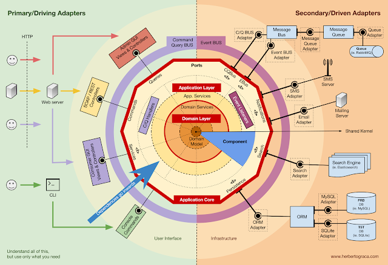

Date: 01/11/2026
Tags: 
[[Architecture logicielle]]

# Questions

# Notes

Aussi appelée Ports and Adapters
Créé par Alistair Cockburn en 2005

- Noyau métier (entités, agrégats DDD, use cases, règles métiers) est indépendant de toute technologie
- Ports : interfaces abstraites définissant les entrées/sorties
- Adaptateurs : implémentations concrètes des ports (exemple : adaptateur REST, message queue...). Orientés vers l'extérieur
- inversion de dépendance / injection de dépendance

Pour aller plus loin :
[The clean architecture](https://blog.cleancoder.com/uncle-bob/2012/08/13/the-clean-architecture.html)

# Références

