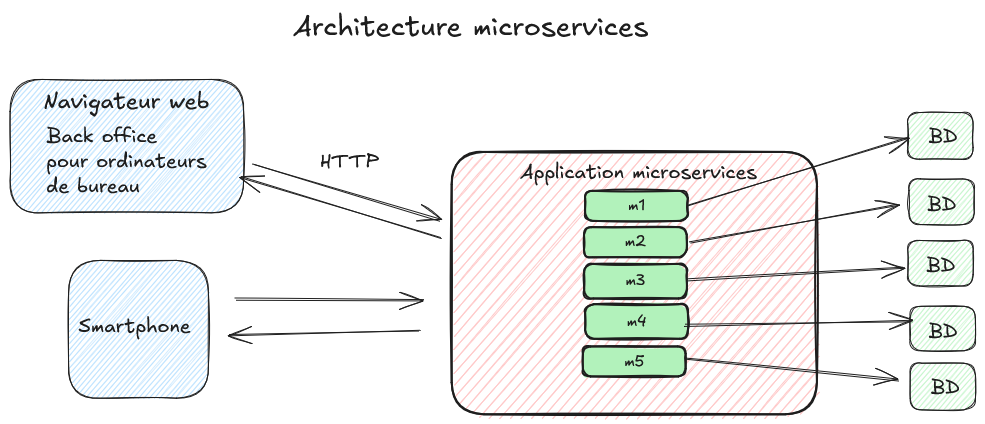

Date: 01/11/2026
Tags: 
[[Architecture logicielle]]

# Questions

# Notes

L'architecture microservices définit une application comme un ensemble de services autonomes, petits et faiblement couplés, organisés autour de capacités métier, déployables indépendamment.
Note : chaque microservice s'exécute dans un processus indépendant
Permet le polyglotisme

- granularité fine
- architecture distribuée
- polyglotisme ( les différents services peuvent utiliser des technologies différentes, les plus adaptée aux objectifs du microservice )

# Références

[https://fr.wikipedia.org/wiki/Microservices](https://fr.wikipedia.org/wiki/Microservices)
[https://martinfowler.com/microservices/](https://martinfowler.com/microservices/)
Pour aller plus loin :
[https://www.geeksforgeeks.org/system-design/microservices-cross-cutting-concerns/](https://www.geeksforgeeks.org/system-design/microservices-cross-cutting-concerns/)
