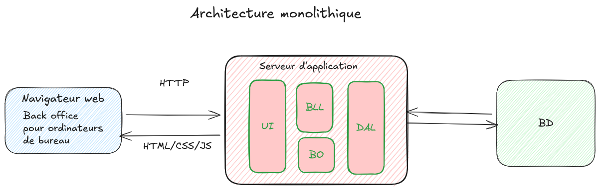

Date: 01/11/2026
Tags: 
[[Architecture logicielle]]

# Questions

# Notes

Une architecture monolithique est une application conçue comme un seul bloc logiciel : toutes les fonctionnalités (UI, logique métier, accès aux données, ...) sont regroupées et déployées ensemble dans une unique base de code.
Inconvénient : mise à l'échelle verticale

En général,on commence par une architecture monolithique avant de dimensionner :
[https://martinfowler.com/bliki/MonolithFirst.html](https://martinfowler.com/bliki/MonolithFirst.html)

# Références

