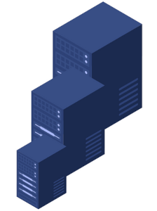
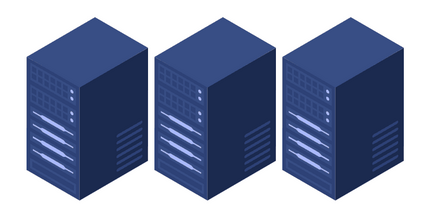

Date: 01/11/2026
Tags: 
[[Architecture logicielle]]

# Questions

# Notes

La scalabilité désigne la capacité d'un système à gérer des charges croissantes (utilisateurs, données, trafic) sans dégradation des performances.

Elle permet aux systèmes de grandir harmonieusement avec la demande. Un système scalable peut augmenter ses ressources (serveurs, stockage, puissance de calcul) selon les besoins, restant fiable et efficace même sous forte charge.

    - Supporte plus d'utilisateurs, données et trafic sans problèmes de performance.
    - Maintient des temps de réponse stables malgré l'augmentation de la charge.
    - Continue à fonctionner de manière fiable lors des pics de trafic.

### Scalabilité verticale :

### Scalabilité horizontale :

# Références

[https://www.geeksforgeeks.org/system-design/what-is-scalability/](https://www.geeksforgeeks.org/system-design/what-is-scalability/)

[https://www.geeksforgeeks.org/system-design/system-design-horizontal-and-vertical-scaling/](https://www.geeksforgeeks.org/system-design/system-design-horizontal-and-vertical-scaling/)
[https://www.geeksforgeeks.org/system-design/what-is-scalability/](https://www.geeksforgeeks.org/system-design/what-is-scalability/)
