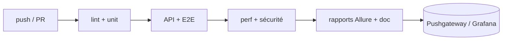

# MiniShop — documentation qualité

Cette documentation est **versionnée avec le code** (docs-as-code) et **republiée à chaque pipeline**.

| Rapport | Où le trouver |
|---|---|
| Catalogue des tests (généré) | [Catalogue](tests/catalogue.md) |
| Rapport Allure | artefact `allure-report` du dernier run / GitHub Pages `/allure/` |
| Couverture | artefact `coverage-html` |
| Tableau de bord | Grafana « Qualité des tests — MiniShop » |

